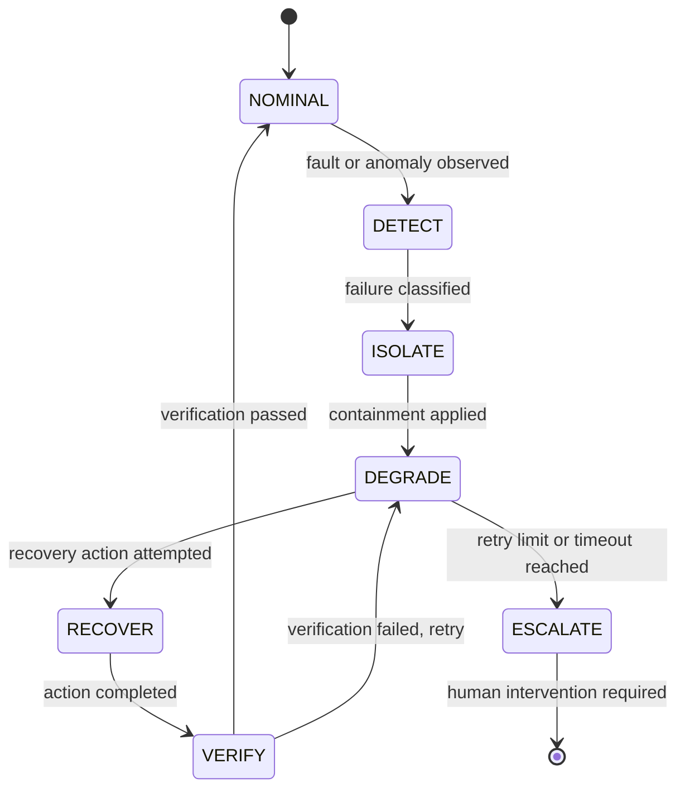

# Failure and Recovery Model

Artifact Type: SPEC
Maturity Status: DESIGN

Formalizes the reliability contract referenced across this repository. No concrete thresholds, timeouts, or safe-state values are specified where they depend on hardware or implementation not yet present in this repository.

## Canonical Sequence

## Failure Classes (categories only; not exhaustive, not hardware-specific)

| Failure Class | Description | Detection Source |
|---|---|---|
| Sensor Invalidation | Sensor Telemetry fails Validation checks | Validation stage |
| Control Loop Fault | Deterministic Control cannot reach a valid next state | Deterministic Control (self-check) |
| Actuator Non-Response | Actuator Feedback Telemetry does not confirm expected effect | State Estimation (feedback comparison) |
| Service Failure | L2 supervised process crashes or hangs | Edge service supervisor |
| Network Partition | L3 connectivity lost between nodes | Network layer health check |
| Policy Violation | A Command is denied or requires approval | Policy Engine |
| Knowledge Staleness | L4 data exceeds an undefined freshness bound | [UNRESOLVED_SPEC: Requires Hardware/Code Verification] |

## Per-Stage Contract

- Detect
  - Failure classes: any listed above.
  - Detection source: per table above.
  - Affected layer: identified at detection time.
- Isolate
  - Containment: remove the faulted component from the active control/service path without affecting unrelated components.
  - [UNRESOLVED_SPEC: Requires Hardware/Code Verification] — concrete isolation mechanism per failure class.
- Degrade
  - Safe-state definition: [UNRESOLVED_SPEC: Requires Hardware/Code Verification] — exact safe actuator positions/service fallback modes are not yet defined; must be defined per deployment before implementation.
  - Escalation owner: Human operator (L1/L2 faults), Edge administrator (L2/L3 faults), per current design; no automated escalation implementation exists.
- Recover
  - Recovery action: restart, reset to safe state, or re-validate inputs, depending on failure class.
  - Timeout: [UNRESOLVED_SPEC: Requires Hardware/Code Verification] — no timeout values are fabricated here.
- Verify
  - Verification condition: State/State Estimate returns to a value consistent with Nominal operation for a defined observation window.
  - Rollback condition: If verification fails after a bounded number of attempts, the system remains in Degrade and escalates rather than looping indefinitely.
  - Evidence emitted: A recovery-event record per [schemas/recovery-event.schema.json](../../schemas/recovery-event.schema.json).

## Cross-Reference

- Recovery is distinct from Deployment rollback; see [docs/foundations/TERMINOLOGY.md](../../docs/foundations/TERMINOLOGY.md).
- Layer-specific recovery responsibility is defined in [architecture/LAYER_CONTRACTS.md](../LAYER_CONTRACTS.md).
- Recovery events must be traceable per [architecture/TRACEABILITY.md](../TRACEABILITY.md).

## Transactional Engineering Change and Migration (Design Pattern)

Engineering changes that alter files, configuration, services, or system state must be treated as bounded transactions rather than as unstructured sequences of commands. This section records a general change-control pattern derived from recent engineering workflow discussions; it does not claim that a universal migration engine or automated transaction framework exists.

### Required sequence

`PRECHECK → INVENTORY → BACKUP / RECOVERY POINT → STAGE → APPLY → INTEGRITY VERIFY → POST-CHANGE VERIFY → COMMIT`

A failed verification must prevent commit. The workflow must preserve a known-good state and define a recovery path before destructive or difficult-to-reverse operations begin.

### Preconditions and invariants

- Establish the current state before mutation: repository/worktree state, target existence, relevant metadata, dependencies, and expected ownership.
- Define the intended target state and explicit success criteria.
- Preserve a recoverable baseline before changing state.
- Prefer atomic operations and bounded scope; do not silently broaden a migration when conflicts are found.
- Where relevant, validate content identity (for example, cryptographic hashes), filesystem identity/metadata, and compatibility references rather than relying on filenames alone.
- A detected conflict, duplicate, unexpected state, or failed precondition is a stop condition—not permission to guess or overwrite.

### Failure behavior

- Stop before the next mutating operation when a precondition fails.
- Isolate the affected operation and preserve diagnostic evidence without exposing secrets or private operational data.
- Roll back only when the rollback procedure is defined and its effects are understood; never treat deletion as a generic recovery mechanism.
- If rollback cannot be verified, retain an explicit INCOMPLETE / RECOVERY REQUIRED state and require human review.
- Do not report a migration as complete merely because an operation returned success; verify the resulting state independently.

### State accounting

Every change record should distinguish:

| State | Meaning |
|---|---|
| KNOWN-GOOD | Last state with sufficient evidence of correct operation |
| CURRENT | Observed state before the proposed change |
| TARGET | Explicit intended state |
| TRANSITION | Change is in progress; completion is not yet established |
| RECOVERY | Rollback or containment is in progress or required |
| VERIFIED | Post-change checks passed against declared success criteria |

The state record should identify the operation scope, preconditions, verification method, stop condition, recovery outcome, and unresolved items. Do not include private filesystem paths, host identifiers, credentials, raw logs, or other operational secrets in public evidence.

### Maturity and evidence boundary

This is a DESIGN-level process contract. Recent use of parts of this sequence in private engineering work is not evidence of a reusable automated migration subsystem, nor does it establish that every operation completed successfully. Any future implementation or measured reliability claim requires its own linked evidence record under the repository's [Evidence Model](../evidence/EVIDENCE_MODEL.md) and [Traceability](../TRACEABILITY.md) rules.
